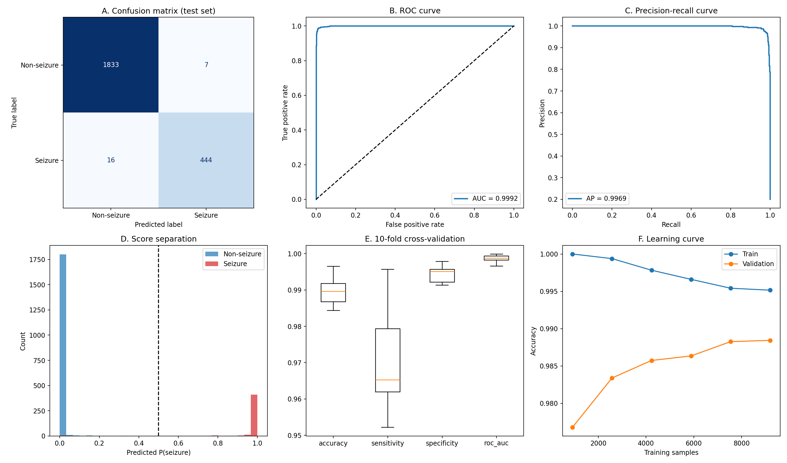

# EEG Seizure Detector

A desktop program (and command-line tool) that screens **EEG recordings and EEG images** for seizure activity, shows where it found it, explains why,
and says "uncertain - please review" when it is not sure. **The trained models are included: download, double-click, use. No training needed.**

> **IMPORTANT: research prototype, not a medical device.** It must not be used for diagnosis, treatment decisions or patient monitoring.
> A qualified clinician must review every EEG. The accuracy figures come mainly from a small public research data set and do **not** show how
> the program performs on new patients or real clinical recordings.

## Download and use (no training required)
1. Download this repository as a zip (**Code > Download ZIP**, or the zip in the **Releases** page) and unzip it.
2. **Windows:** double-click **`START_HERE.bat`**. The first start installs the needed Python packages (3-6 minutes, internet needed); later starts open instantly.
   **macOS / Linux:** `./start.sh` (Linux: `sudo apt install python3-venv python3-tk` first).
3. In the program, open the **Information** tab: *1. How to use and input formats* explains everything, with buttons that load a ready-made example;
   *2. Training evidence* shows the graphs and numbers from training.

Manual install: `pip install -r requirements.txt` then `python gui.py`. Needs Python 3.10-3.13 with Tkinter. The models were trained with
**scikit-learn 1.6.1** and may not load with other versions, so `requirements.txt` pins it.

## What you get
| Part | Description |
|---|---|
| **Recording mode** | EDF, BDF, CSV, TXT or NPY. The signal is cut into 1.03 s windows; you get a verdict, an event table (start / end / duration), a plot and exports. |
| **Image mode** | PNG/JPG screenshot or scan of an EEG. The curves are read from the picture; enter the vertical scale (**uV per pixel**) for accurate results. |
| **Uncertain zone** | Ambiguous windows are marked "uncertain" instead of being forced into yes / no. |
| **Explanations** | Each detected event lists the signal features that drove it. |
| **In-program guide** | Information tab: usage, accepted input formats, how to find the image scale, and the training evidence (graphs). |
| **Sample files** | `samples/inputs` (one example per input format) and `samples/outputs` (what the program writes). |
| **Training report** | `TRAINING_REPORT.md` / `.html`: all results of the training run in readable form. |
| **Command line / live demo** | `predict.py` for files and folders; `live_demo.py` replays a file as a live stream. |

## Results at a glance
Held-out test set (n = 2300 one-second segments from the Bonn / UCI data):

| Metric | Value |
|---|---|
| Accuracy | 99.00% (95% CI 98.61% - 99.35%) |
| Sensitivity (seizures found) | 96.52% (95% CI 94.87% - 98.16%) |
| Specificity | 99.62% (95% CI 99.30% - 99.89%) |
| ROC-AUC | 0.9992 |

- **Uncertain zone:** 2.26% of segments are sent to review; on the rest accuracy is 99.42%.
- **Image mode:** accuracy 98.22% (sensitivity 93.48%) when the uV-per-pixel scale is entered correctly, but only 92.30% without it - on *simulated* images.
- **Nonlinear models** (SVM, random forest, gradient boosting) are not significantly better than the logistic regression used here.
- An experimental multichannel stage (leave-one-patient-out on CHB-MIT) is documented in the training report: it detects seizures with many false alarms, and its pre-seizure score is not predictive (disabled).

Full details, all figures and the sanity checks: **[TRAINING_REPORT.md](TRAINING_REPORT.md)**. A web version is in `TRAINING_REPORT.html`.

## How it works (short)
Windows -> 19 signal features (feature set used: base (19 features)) -> logistic regression -> conformal thresholds (non-seizure / uncertain / seizure) -> events.
Images are digitised (trace pixels -> signal) and, with the scale known, analysed by the same model. The code is organised in the `eegseizure` package;
read **[docs/CODE_GUIDE.md](docs/CODE_GUIDE.md)** for the architecture, and **[docs/USER_GUIDE.md](docs/USER_GUIDE.md)** for usage.

## Limitations and responsible use
- The Bonn data have no patient IDs; neighbouring segments of one recording can land in both training and test sets, so the accuracy is optimistic
  and says nothing about unseen patients. Continuous clinical EEG is much harder (many false alarms).
- Image mode was tested only on simulated images; a wrong scale or a photo of a screen hurts accuracy.
- The single-channel model was trained on a few adults; the multichannel model on a few children and is experimental.
- Amplitudes must be in microvolts. Outputs can be wrong - always review the EEG yourself.

## Reproduce the results (optional)
The trained models and results are already in this repository. To reproduce them: open `notebooks/reproduce_in_colab.ipynb` in Google Colab (badge above)
or run locally:
~~~
pip install -r requirements-train.txt
python -m pytest tests
python train_models.py          # models, metrics, figures
python make_samples.py          # sample inputs and reference outputs
python compare_models.py        # headroom check against nonlinear models
python train_multichannel.py    # optional: experimental stage, downloads ~3 GB
python build_release.py         # README, TRAINING_REPORT, checksums, zip
~~~
Seed 0. Software versions and the SHA-256 of the data file are in `results/metrics.json`; checksums of models and code in `results/SHA256SUMS.txt`.
Data: Kaggle `harunshimanto/epileptic-seizure-recognition` (a CSV copy of the UCI / Bonn data); CHB-MIT from PhysioNet.

## Repository layout
~~~
START_HERE.bat  start.sh          launchers
gui.py  predict.py  live_demo.py  the program, command line, live demo
eegseizure/                       library (see docs/CODE_GUIDE.md)
models/                           trained models (used by the program)
results/                          metrics, figures, logs
samples/inputs  samples/outputs   example inputs and reference outputs
docs/                             USER_GUIDE.md (also shown in the program), CODE_GUIDE.md
train_models.py  make_samples.py  compare_models.py  train_multichannel.py  build_release.py     reproduction scripts
tests/                            unit tests
TRAINING_REPORT.md / .html  MODEL_CARD.md  CHANGELOG.md  CITATION.cff  LICENSE
~~~

## FAQ and troubleshooting
- **"A model file could not be loaded"** - install the pinned scikit-learn: `pip install scikit-learn==1.6.1`, or use `START_HERE.bat`.
- **EDF will not open** - `pip install mne`; or export to CSV. **No window on Linux** - `sudo apt install python3-tk`.
- **Image: wrong channel count** - set *Channels* by hand and trim labels. **Everything "uncertain"** - check units (uV) and sampling rate.
- **Can I use it clinically?** No.
More in the guide (Information tab).

## Citation
Cite the software via `CITATION.cff` (Zenodo mints a DOI for every GitHub release) and the data:
- Andrzejak RG, Lehnertz K, Mormann F, Rieke C, David P, Elger CE (2001). Indications of nonlinear deterministic and finite-dimensional structures in time series of brain electrical activity. *Phys. Rev. E* 64, 061907.
- Shoeb AH (2009). Application of machine learning to epileptic seizure onset detection and treatment. PhD thesis, MIT; Goldberger AL et al. (2000). PhysioBank, PhysioToolkit, and PhysioNet. *Circulation* 101(23), e215-e220 (CHB-MIT).
Check each data set's terms before redistributing data; this repository contains trained models, figures and small demo excerpts only.

## License
MIT - see [LICENSE](LICENSE) (code, trained models and documentation). Data sets keep their own licenses. See also [MODEL_CARD.md](MODEL_CARD.md), [CHANGELOG.md](CHANGELOG.md), [CONTRIBUTING.md](CONTRIBUTING.md).
