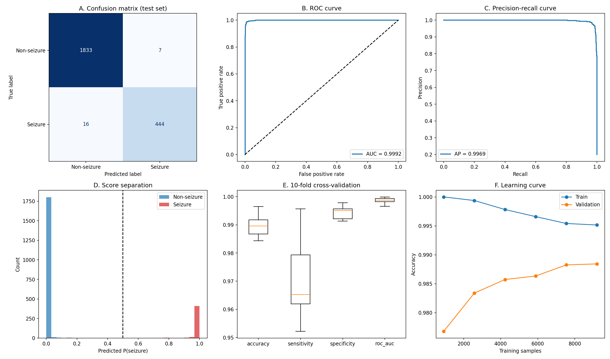
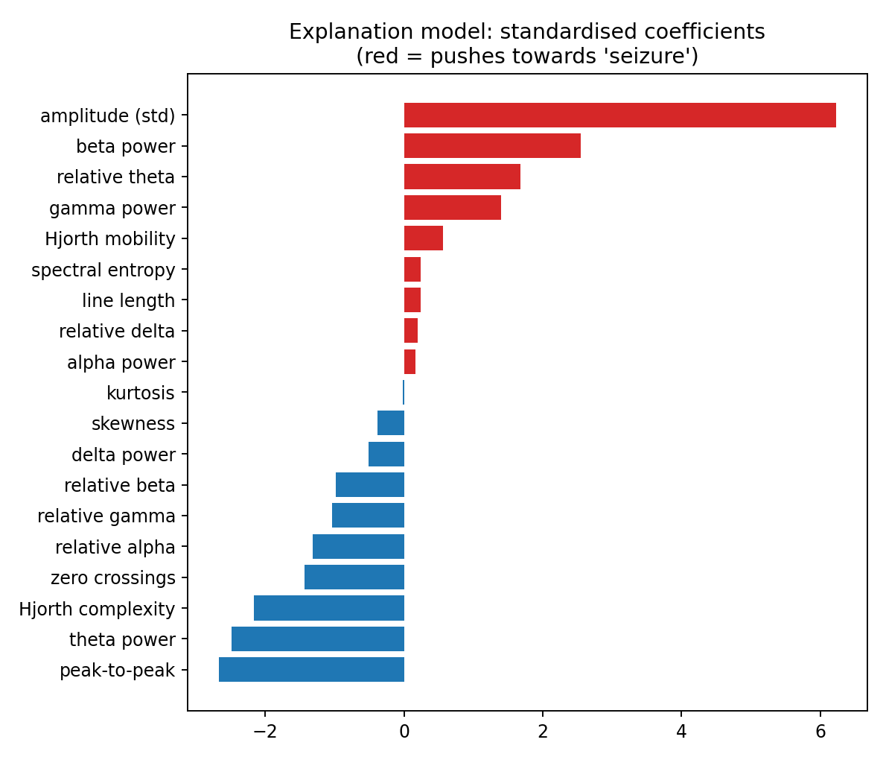
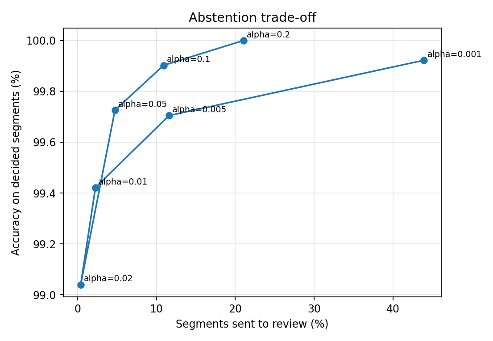
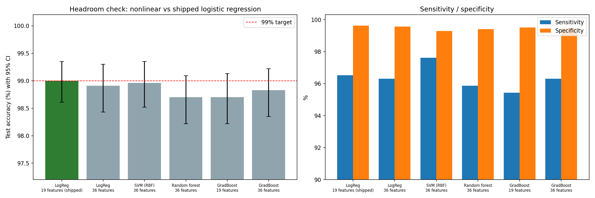
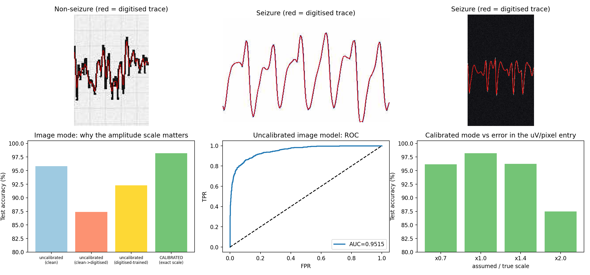
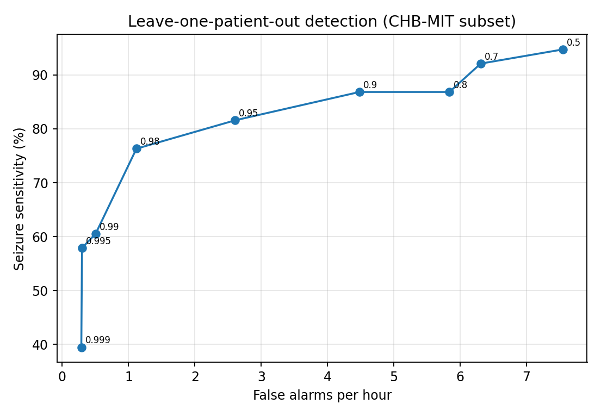
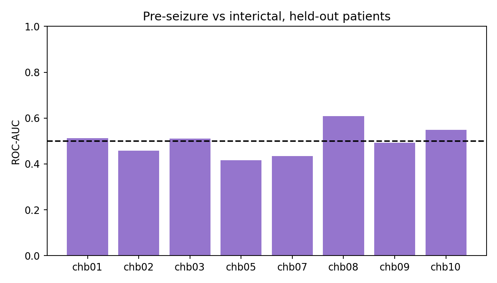

# Training report - EEG Seizure Detector v1.0.0

This report is generated automatically from the output of the training scripts (`train_models.py`, `compare_models.py`, `train_multichannel.py`). Every number was measured on **held-out test data** that the models never saw during training. Nothing here needs to be re-run to use the program: the trained models are already in the `models/` folder.

## 1. Data and set-up
- **Data:** Bonn / UCI *Epileptic Seizure Recognition* - 11,500 one-second segments (178 samples at 173.61 Hz); seizure = class 1, all other classes = non-seizure.
- **Split:** 80% training / 20% test (stratified, seed 0). Hyper-parameters were chosen by cross-validation on the training part only.
- **Software:** Python 3.13.18, scikit-learn 1.6.1, numpy 2.4.6, scipy 1.16.3.
- **Data file SHA-256:** `5ac55c71de5df20d2f47c39300c5b61df18ac5d1c40315e586310b794c32a98b`

## 2. Segment model (single-channel detector)
| Metric | Held-out test set (n = 2300) |
|---|---|
| Accuracy | 99.00% (95% CI 98.61% - 99.35%) |
| Sensitivity (seizures found) | 96.52% (95% CI 94.87% - 98.16%) |
| Specificity (non-seizure correct) | 99.62% (95% CI 99.30% - 99.89%) |
| ROC-AUC | 0.9992 |
| Matthews correlation | 0.9686 |

Errors: 16 of 460 seizure segments missed; 7 of 1840 non-seizure segments flagged.
10-fold cross-validation accuracy: 0.9896 +/- 0.0036.

**Sanity checks** (is the result real?)
- Majority-class baseline accuracy: 0.8 (always answering 'non-seizure').
- With shuffled labels the same pipeline scores 0.8 - no better than the baseline (100 permutations, p = 0.010), so the pipeline does not leak labels.
- Feature set: **base (19 features)**, chosen by cross-validation on the training part (CV accuracy base 0.9884 vs extended 0.9882).

The learning curve (panel F) shows the validation accuracy still rising slowly with more training data.

## 3. The 'uncertain' zone (conformal abstention)
The model may answer 'uncertain - review' instead of guessing. With a target error of 1%: **2.26% of test segments are sent to review**, and on the rest accuracy is **99.42%** (13 errors in 2248). The calibration uses out-of-fold scores of the training data (cross-conformal), so the error target is approximate and assumes new data resemble the training data.

## 4. Why logistic regression? Headroom check
Same split and test set; hyper-parameters chosen on the training part only.

| Model | Test accuracy (95% CI) | Sensitivity | Specificity | 5-fold CV | McNemar p vs shipped |
|---|---|---|---|---|---|
| Logistic regression, 19 features (shipped) | 99.00% (98.61 - 99.35) | 96.52% | 99.62% | 98.92% | 1.0 |
| Logistic regression, 36 features | 98.91% (98.43 - 99.30) | 96.30% | 99.57% | 98.88% | 0.8318 |
| SVM (RBF), 36 features | 98.96% (98.52 - 99.35) | 97.61% | 99.29% | 99.10% | 1.0 |
| Random forest, 36 features | 98.70% (98.22 - 99.09) | 95.87% | 99.40% | 98.80% | 0.1892 |
| Gradient boosting, 19 features | 98.70% (98.22 - 99.13) | 95.43% | 99.51% | 99.07% | 0.1185 |
| Gradient boosting, 36 features | 98.83% (98.35 - 99.22) | 96.30% | 99.46% | 99.10% | 0.4545 |

**Best nonlinear model (SVM (RBF), 36 features) reaches 98.96% vs 99.00% for the shipped logistic regression (-0.04 points, McNemar p = 1.0). The difference is not statistically significant.** The ceiling of about 99% comes from the data (overlapping classes), not from the model type, so the simple, explainable linear model is used. The shipped model is the first row.

## 5. Image mode (tested on simulated images of held-out segments)
| Mode | Accuracy | Sensitivity | Specificity |
|---|---|---|---|
| **Calibrated** (correct uV per pixel) | **98.22%** | 93.48% | 99.40% |
| Calibrated, scale entered 30% too small | 96.17% | 81.74% | 99.78% |
| Calibrated, scale entered 40% too large | 96.26% | 95.87% | 96.36% |
| Calibrated, scale entered 2x too large | 87.48% | 96.09% | 85.33% |
| Uncalibrated (scale unknown) | 92.30% | 72.61% | 97.23% |

Calibrated mode abstains on 3.09% of windows. Uncalibrated mode abstains on 63.13% and is a weak fallback: a picture without a scale hides how large the waves are. **These are simulated images, not real photographs.**

## 6. Stage 2: multichannel detector and pre-seizure score (experimental)
CHB-MIT subset: 8 patients (chb01, chb02, chb03, chb05, chb07, chb08, chb09, chb10), 97.5 hours, evaluated **leave-one-patient-out** (the model never sees the test patient).

At threshold 0.99: **60.5% of seizures detected** with **0.50 false alarms per hour (about 12 per day)** - far too many for practical use.

| Patient | Hours | Seizures | Detected | False alarms | Pre-seizure AUC |
|---|---|---|---|---|---|
| chb01 | 9.0 | 6 | 1 | 0 | 0.51 |
| chb02 | 5.3 | 3 | 1 | 4 | 0.46 |
| chb03 | 9.0 | 6 | 0 | 1 | 0.51 |
| chb05 | 8.0 | 5 | 5 | 9 | 0.42 |
| chb07 | 20.4 | 3 | 3 | 3 | 0.43 |
| chb08 | 8.0 | 5 | 5 | 1 | 0.61 |
| chb09 | 19.8 | 4 | 4 | 17 | 0.49 |
| chb10 | 18.0 | 6 | 4 | 14 | 0.55 |

**Pre-seizure ('early warning') score:** mean held-out ROC-AUC 0.498 (0.5 = chance) - not predictive, so it is **disabled in the program**.

## 7. How to read these numbers
- The Bonn data have no patient identifiers, so segments from one recording can sit in both training and test sets: accuracy is optimistic and does not show performance on new patients.
- Continuous clinical EEG is much harder than these short, clean segments - see the false-alarm rate in section 6.
- Image results come from simulated images; test real screenshots before relying on image mode.
- This is a research prototype and not a medical device.

## 8. Raw outputs
- `results/metrics.json`, `results/model_comparison.json`, `results/chb_metrics.json` - all numbers in machine-readable form.
- `results/logs/` - console output of the training run.
- `results/SHA256SUMS.txt` - checksums of the models and code.
